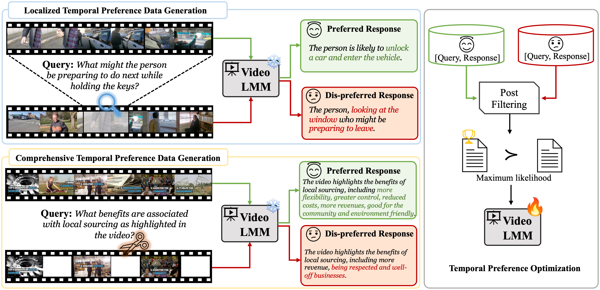

# 🎬 Temporal Preference Optimization (TPO) for Long-Form Video Understanding

<a href='https://arxiv.org/abs/2501.13919v3'></a> <a href='https://ruili33.github.io/tpo_website/'></a> <a href='https://huggingface.co/collections/ruili0/temporal-preference-optimization-67874b451f65db189fa35e10'></a> <a href='https://huggingface.co/collections/ruili0/temporal-preference-optimization-67874b451f65db189fa35e10'></a> 


</div>

---

## 📖 Overview

**Temporal Preference Optimization (TPO)** is a self-training framework designed to enhance long-form video understanding capabilities in video Large Multimodal Models (video-LMMs). Our approach significantly improves video comprehension by modeling temporal preferences at two complementary granular levels.

<div align="center">

</div>

### 🔑 Key Innovations

- **🎯 Localized TPO**: Generates queries focused on short video segments with contrastive responses that retain or exclude target segments
- **🌐 Comprehensive TPO**: Designs broader understanding queries using intact videos versus sparse downsampled videos for response contrast  
- **🔧 Intelligent Post-filtering**: Ensures high-quality contrast response pairs through multi-dimensional filtering mechanisms
- **🚀 Self-training Pipeline**: Complete end-to-end framework for temporal preference optimization

### ✨ Key Features

- 📊 **Significant Performance Gains**: Achieves substantial improvements across multiple video understanding benchmarks
- 📚 **Comprehensive Pipeline**: Complete toolkit from data curation to model training
- 🔬 **Reproducible Research**: Full codebase and datasets for research reproducibility


## 🚀 Quick Start

### 📦 Pre-trained Model Weights

We provide high-performance model weights trained with TPO:

| Model | Base Architecture | HuggingFace Link | Description |
|:---:|:---:|:---:|:---:|
| LongVA-7B-TPO | LongVA-7B | [🤗 Download](https://huggingface.co/ruili0/LongVA-7B-TPO) | Optimized for long-form video understanding |
| LLaVA-Video-7B-TPO | LLaVA-Video-7B | [🤗 Download](https://huggingface.co/ruili0/LLaVA-Video-7B-Qwen2-TPO) | General-purpose video comprehension model |

### 🛠️ Installation


#### Option 1: LongVA-TPO Setup
```bash
# Clone the repository
git clone https://github.com/ruili33/TPO
cd TPO

# Create conda environment
conda create -n TPOLongVA python=3.10
conda activate TPOLongVA

# Install dependencies
conda install ffmpeg
pip install torch==2.1.2 torchvision --index-url https://download.pytorch.org/whl/cu118
pip install -e "longva/.[train]"
pip install packaging ffmpeg-python ninja
pip install flash-attn==2.5.0 --no-build-isolation --no-cache-dir
pip install -r requirements_longva.txt
```

#### Option 2: LLaVA-Video-TPO Setup
```bash
# Create conda environment
conda create -n TPOllava python=3.10 -y
conda activate TPOllava

# Install dependencies
conda install ffmpeg
pip install --upgrade pip 
pip install torch==2.1.2 torchvision --index-url https://download.pytorch.org/whl/cu118
pip install -e "LLaVA/.[train]"
pip install flash-attn==2.5.0 --no-build-isolation --no-cache-dir
pip install ffmpeg-python
```

### 🎯 Model Inference

For LongVA-TPO, please following the inference demo in `longva/inference_longva.py`.

For LLaVA-Video-TPO, please following the inference demo in `LLaVA/inference_llava.py`.


### 📊 Model Evaluation

We utilize the [lmms-eval](https://github.com/EvolvingLMMs-Lab/lmms-eval) framework for standardized evaluation, ensuring consistency with previous works.

#### Evaluation Scripts
```bash
# LongVA-TPO evaluation
bash longva/eval.sh

# LLaVA-Video-TPO evaluation  
bash LLaVA/eval.sh
```

### 📦 Datasets

| Dataset | Description | Link |
|:---:|:---:|:---:|
| LongVA-TPO-10k | TPO training dataset for LongVA | [🤗 Dataset](https://huggingface.co/datasets/ruili0/LongVA-TPO-10k) |

### 🌐 Web Demo

Experience our TPO model (LLaVA-Video-7B-TPO) with an interactive web interface:

```bash
conda activate TPOllava
python local_demo/multimodal_chat.py
```

Visit the local server URL to start interactive video question-answering.


## 🔧 Training

### TPO Training Pipeline

#### LLaVA-Video-TPO Training
```bash
# Run TPO training script
bash LLaVA/tpo_video.sh
```

#### LongVA-TPO Training
```bash
# Run TPO training script
bash longva/longva/source/TPO.sh
```

### 📈 TPO Data Curation Pipeline

Detailed implementation scripts are available in the `data/` directory.


## 📝 Citation

If you find this repository useful in your research or work, please consider citing our paper:

```bibtex
@article{li2025temporal,
      title={Temporal Preference Optimization for Long-Form Video Understanding},
      author={Li, Rui and Wang, Xiaohan and Zhang, Yuhui and Zohar, Orr and Wang, Zeyu and Yeung-Levy, Serena},
      journal={arXiv preprint arXiv:2501.13919},
      year={2025}
}
```

## 🙏 Acknowledgements

This work builds upon the excellent open-source projects [LongVA](https://github.com/EvolvingLMMs-Lab/LongVA) and [LLaVA-Video](https://github.com/LLaVA-VL/LLaVA-NeXT). We extend our sincere gratitude to the maintainers and contributors of these repositories for their outstanding work, which greatly facilitated the development of our project.


---

<div align="center">

**⭐ If you find this project helpful, please give us a star!**


</div>